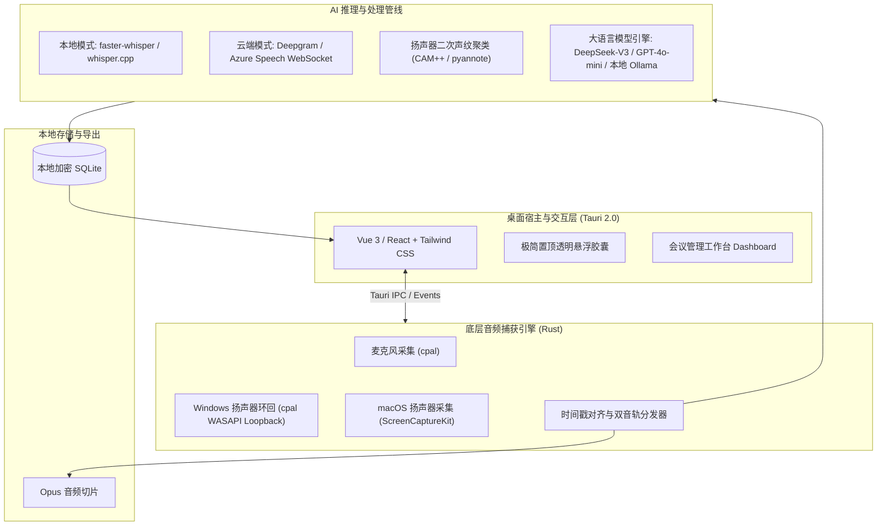
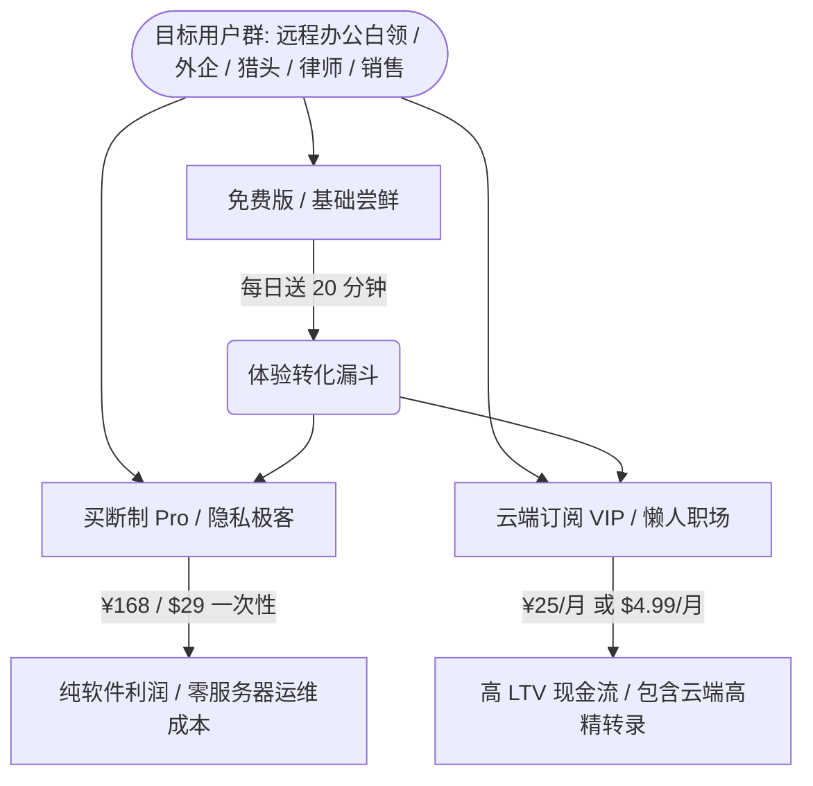
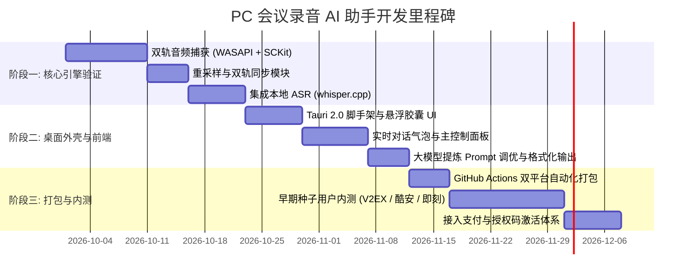

# PC 会议录音 AI 助手：可行性报告与产品说明书 (PRD)

> **文档定位**：面向独立开发者的项目立项、技术选型、架构落地与商业化全景指导方案。  
> **项目代号**：*MeetWhisper / 会议副驾*（暂定）  
> **核心定位**：非侵入式（无机器人入会）、跨软件、双轨物理分角色、支持本地离线隐私的跨平台（Windows / macOS）会议效率副驾。

---

## 目录
1. [执行摘要与商业机会](#一执行摘要与商业机会)
2. [市场可行性与竞品差异化分析](#二市场可行性与竞品差异化分析)
3. [产品功能规范说明书 (PRD)](#三产品功能规范说明书-prd)
4. [系统整体技术架构设计](#四系统整体技术架构设计)
5. [底层核心技术实现方案](#五底层核心技术实现方案)
6. [后期技术实现难题与避坑指南](#六后期技术实现难题与避坑指南)
7. [商业化与盈利模式](#七商业化与盈利模式)
8. [开发里程碑与实施路线图](#八开发里程碑与实施路线图)

---

## 一、执行摘要与商业机会

随着远程办公、跨国沟通与分布式协作成为常态，职场人每周耗费在各类线上会议（腾讯会议、Zoom、Teams、Google Meet、飞书）上的时间成倍增加。“开会听不全、漏记关键待办、会后手写纪要耗时 1~2 小时”是全球白领的普遍痛点。

传统大厂方案（如飞书妙记、腾讯会议 AI）存在**严重生态割裂**，而海外明星产品（Otter、Fireflies）因强制“拉机器人进会”导致**企业合规阻力大、侵犯商业机密**。

本项目立足于 **PC 桌面操作系统底层**，通过操作系统原生音频管线，实现“静默、无感、跨软件”的双轨录音，配合现代端侧语音识别模型与大语言模型，输出高可用度、结构化的会议决议与待办清单。

---

## 二、市场可行性与竞品差异化分析

### 1. 竞品矩阵对比

| 竞品类别 | 代表产品 | 优势 | 致命缺陷 / 用户痛点 | 本产品的突破机会 |
| :--- | :--- | :--- | :--- | :--- |
| **云端会议机器人** | Otter.ai, Fireflies.ai | 识别准、自动化程度高 | 必须拉机器人入会；许多企业明令禁止；隐私合规风险极大；中文较弱 | **完全无感、非侵入式，会议界面无任何第三方标记** |
| **平台内置助手** | 飞书妙记、腾讯会议 AI | 深度集成于自身 App | 平台互不兼容；跨软件（如微信语音、Zoom）无法统一管理 | **全局常驻，无论用什么软件开会都能无缝录制** |
| **单向文件转录** | MacWhisper | 买断制口碑好、本地离线 | 只做录音文件转文字；没有双轨分角色；无深度纪要工作流 | **双音轨物理分离“我”和“参会人”，自带 LLM 结构化提炼** |
| **系统级监控** | Rewind / Limitless | 记录一切屏幕与音频 | 隐私恐惧感强；全天监控占用过高资源；价格极昂贵 | **轻量专注：只在会议时工作，资源占用低于 50MB** |

---

## 三、产品功能规范说明书 (PRD)

### 1. 产品形态设计
* **极简悬浮小胶囊（Floating Pill）**：
  * 平时自动吸附在屏幕边缘或置顶，仅显示录音状态、实时音量波形及运行时长。
  * 支持全局快捷键触发（如 `Alt + M` 或 `Cmd + Shift + R` 一键启停）。
* **主工作台抽屉（Drawer / Dashboard）**：
  * 点击悬浮胶囊展开，分为左右双栏：
    * **左侧**：历史会议列表、标签筛选（项目、日期、部门）。
    * **右侧**：当前会议的双轨实时对话流、AI 会议纪要卡片。

### 2. 核心功能清单

```mermaid
mindmap
  root((会议AI助手))
    音频捕获
      麦克风内录(我的声音)
      扬声器环回(对方的声音)
      声卡热插拔检测
    实时转录
      流式语音识别
      角色物理分流(我 vs 对方)
      声纹细分(对方1 vs 对方2)
    智能后处理
      去除语气词/卡顿
      会议主题与摘要生成
      决策共识归纳
      待办事项(TODO)提取
    导出与集成
      Markdown / PDF 导出
      一键复制到 Notion / 飞书
      本地数据库加密归档
```

#### Phase 1 (MVP 必备功能)
1. **一键双轨录音**：无需配置虚拟声卡，自动捕获默认麦克风与扬声器。
2. **实时/近实时文本生成**：支持中、英、日等主流语言自动识别。
3. **角色物理分离**：对话列表以左右气泡或明确标签标注：`[我]` 与 `[参会对方]`。
4. **一键 AI 纪要**：会议结束后 10 秒内生成 Markdown 格式的报告：
   * **会议摘要**：一句话背景 + 核心议题。
   * **决策事项（Decisions）**：本次会议敲定的事项。
   * **待办清单（Action Items）**：责任人、事项明细。
5. **导出能力**：一键复制为格式化富文本、Markdown，或导出为本地音频 + 字幕文件。

#### Phase 2 (进阶高价值功能)
1. **扬声器多人声纹聚类**：进一步区分“参会人 A”与“参会人 B”。
2. **多语言同传悬浮字幕**：跨国会议时，屏幕边缘实时滚动母语翻译。
3. **生词本与自定义词库**：允许用户添加行业术语、人名、项目缩写，提升识别率。
4. **离线隐私模式**：完全断网环境下调用本地模型生成纪要。

---

## 四、系统整体技术架构设计



---

## 五、底层核心技术实现方案

### 1. 桌面容器选型：Tauri 2.0 (Rust + Web)
* **选型理由**：
  * 安装包仅 **15MB ~ 25MB**（Electron 普遍 100MB+）。
  * 运行时内存仅 **30MB ~ 60MB**，绝不与 Zoom/PPT 抢占内存。
  * 原生支持多窗口（主窗口 + 鼠标穿透置顶悬浮窗）。

### 2. 双平台音频采集实现细节

#### Windows 端实现（原生免驱动）
* **依赖库**：`cpal`
* **原理**：调用 Windows WASAPI Loopback。
* **代码逻辑**：
  ```rust
  // 获取扬声器设备，构建输入流（WASAPI Loopback 自动激活）
  let speaker_device = cpal::default_host().default_output_device().unwrap();
  let speaker_stream = speaker_device.build_input_stream(
      &config,
      move |data: &[f32], _| {
          // 处理对方的声音流
      },
      err_fn,
      None
  )?;
  ```

#### macOS 端实现（原生免驱动，针对 macOS 13+）
* **依赖库**：`screencapturekit-rs`
* **原理**：利用苹果官方 `ScreenCaptureKit` 的 Audio-Only 模式截流。
* **避坑要点**：
  * **不要**申请录屏权限去捕获视频帧，只配置 `capturesAudio = true`。
  * 引导用户前往系统偏好设置勾选“屏幕与系统音频录制”权限。

### 3. AI 会议纪要 Prompt 工程结构设计

```text
你是一名世界顶尖的专业会议秘书。请对以下带有时间戳和发言人标识的双轨会议记录进行梳理。

【约束规则】：
1. 过滤掉所有语气助词（如：嗯、啊、那个、其实、对对对）及重复结巴语句。
2. 保持事实严谨，禁止无中生有。
3. 严格输出标准 JSON 格式。

【输出结构规范】：
{
  "title": "简短有吸引力的会议主题",
  "summary": "100-200字核心背景与结论概述",
  "topics": [
    {
      "name": "讨论议题1",
      "consensus": "达成的核心共识",
      "key_points": ["核心观点A", "核心观点B"]
    }
  ],
  "action_items": [
    {
      "owner": "责任人姓名/我/对方",
      "task": "具体可执行的任务动作",
      "due_date": "截止时间（若有提及，未提及填暂无）"
    }
  ]
}
```

---

## 六、后期技术实现难题与避坑指南

### 难点 1：macOS 权限审查与系统休眠断流
* **表现**：
  * macOS 对隐私权限控制极严，应用被用户在系统设置撤销权限后若无错误处理会导致崩溃。
  * 笔记本合盖或屏幕熄灭时，音频流会静默中断。
* **应对策略**：
  * 启动时做权限自检（Permission Preflight），未授权时显示友好的交互引导动图。
  * 监听系统的 `NSWorkspace` 电源管理事件，在系统唤醒后自动重启音频流。

### 难点 2：扬声器端“多人混杂”的分离难题
* **表现**：
  * 双轨只能分清“我”和“他们”。如果线上会议对方有 5 个人轮流发言，扬声器轨道出来的文字全被标记为“对方”。
* **应对策略**：
  * **阶段一（极简实用主义）**：将 LLM 纳入推理。大模型具备强大的语境理解力，在上下文出现“张总您怎么看”、“李工刚才说的”时，能自动推断部分角色名。
  * **阶段二（声纹向量聚类）**：扬声器音频流切片提取声纹嵌入（Speaker Embeddings），使用轻量级 CAM++ 模型，将相似声纹聚类为 `对方发言人 1`、`对方发言人 2`。

### 难点 3：声卡/蓝牙耳机热插拔与采样率突变
* **表现**：
  * 开会中途用户拔掉 AirPods 切换成电脑扬声器，或者插入 USB 麦克风，底层音频流句柄会直接失效（Panic）。
  * 蓝牙耳机采样率通常为 16000Hz，而扬声器为 48000Hz，采样率不匹配导致声音变成“花栗鼠音”或卡顿。
* **应对策略**：
  * 实现设备状态监听器（Device Event Listener），捕获设备断开与切换事件，具备 **0.5 秒内自动无感重连**能力。
  * 内置统一重采样模块（Resampler），无论输入是 44.1kHz、48kHz 还是 16kHz，统一在 Rust 层线性重采样至 **16kHz 单声道**（Whisper 最爱的标准格式）。

### 难点 4：双平台代码签名与杀毒软件误报
* **表现**：
  * 因为软件涉及“录制系统扬声器声音”，在 Windows 上极易被 360 或 Windows Defender 判定为“窃听风险/流氓软件”。
  * macOS 缺少签名会导致“无法打开，因为无法验证开发者”。
* **应对策略**：
  * **Mac**：必须购买每年 \$99 的 Apple Developer 证书，在 CI/CD 中完成自动公证（Notarization）。
  * **Windows**：申请 EV 代码签名证书（后期），初期在官网发布详细指引，并在 GitHub 开源部分核心音频捕获驱动代码以建立信任。

---

## 七、商业化与盈利模式



### 1. 定价矩阵规划

| 版本 | 价格定位 | 包含权益 | 成本结构 |
| :--- | :--- | :--- | :--- |
| **免费体验版** | 免费 | 每日免费 20 分钟录制与纪要；本地轻量模型识别 | 纯端侧计算，成本为 0 |
| **终身买断版 (Pro)** | **¥168 ~ ¥298**<br>(\$29 ~ \$49) | 无限时长本地录制；支持自定义导入 OpenAI/DeepSeek API Key (BYOK)；本地数据离线加密 | 零服务器成本，纯利润 |
| **云端全能订阅 (VIP)** | **¥25 / 月** 或 **¥198 / 年**<br>(\$4.99/mo, \$39/yr) | 官方托管云端大型模型（极速秒出、免配置）；提供无限次高质量 AI 提炼与待办管理 | 每小时音频云成本约 ¥0.2~¥0.5，毛利率 > 75% |

---

## 八、开发里程碑与实施路线图



### 首期行动指南（接下来 3 天的攻坚重点）：
1. 用 **Rust 写一个独立的命令行控制台小程序**：
   * 验证在当前电脑上能否通过 `cpal` 成功录下 10 秒麦克风声音，并录下耳机正在播放的音乐声音；
   * 保存为 `mic.wav` 和 `speaker.wav`，用播放器播放验证双声道清晰度。
2. 搭建 **Tauri 2.0** 初始化项目，验证置顶透明悬浮窗（Frameless + AlwaysOnTop）在 Windows/Mac 上的渲染表现。
